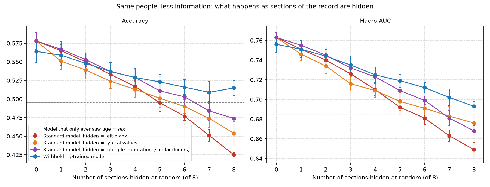
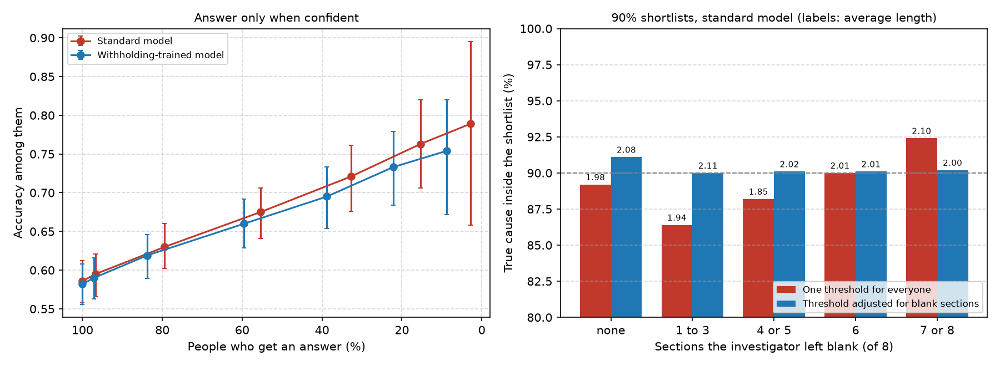
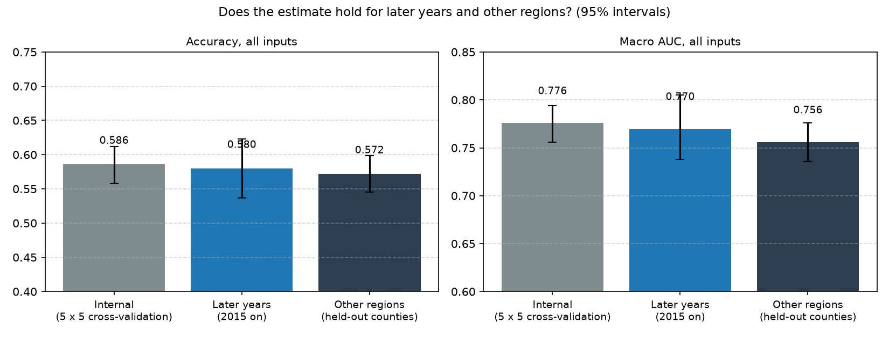

# Estimating the Cause of Death from Incomplete Medicolegal Records

**Lifestyle and cause of death in medicolegal deaths, using metadata from the New Mexico Decedent Image Database (NMDID)**

CSE 499A Capstone Project, North South University · **Status:** analysis complete; manuscript in preparation

Death investigators record lifestyle and medical history unevenly, and much of a record is often blank. This project asks how well the broad cause of death can be estimated from such records, and what happens to that estimate when parts of the record are missing. It compares five ways of handling missing information, gives shortlists of causes with a stated coverage, and checks every result on people the models never saw, on later years and on other regions. Individual-level data are never shared; only aggregate results are in this repository.

## Contents
- [Research statement](#research-statement)
- [Data and outcomes](#data-and-outcomes)
- [Main findings](#main-findings)
- [Key figures](#key-figures)
- [Methods in brief](#methods-in-brief)
- [Limitations](#limitations)
- [Repository structure](#repository-structure)
- [Reproducing the results](#reproducing-the-results)
- [Demo app and deployment](#demo-app-and-deployment)
- [Output tables](#output-tables)
- [Data source](#data-source)

## Research statement
From a person's recorded lifestyle and medical history, how well can we estimate the broad cause of death, and how much does the estimate suffer when parts of the record are missing?

1. **Accuracy.** How often does a model name the correct broad cause, and what is the most these records can support?
2. **Missing information.** How much accuracy is lost when sections of the record are missing, and does a model trained with randomly withheld sections cope better?
3. **Reliability.** When can a single estimate be trusted? Calibration, answering only when confident, and shortlists that contain the true cause 90%, 95% or 99% of the time.
4. **Explanation.** Why does the estimate survive missing information? How much comes from what the record says, and how much from which sections investigators filled in?

## Data and outcomes
Structured metadata of 1,450 adult decedents, de-duplicated from 1,500 records in three NMDID data carts, with eight linked tables per person. Each record has eight sections: drinking, tobacco, drug use, marital status, body size, education and work, diagnoses, and past injuries and surgery.

| Outcome | People | Classes |
|---|---|---|
| Primary: broad cause of death | 1,380 | natural cardiac (373), drug or alcohol (500), injury (507) |
| Secondary: intent within injury deaths | 487 | accident (215), homicide (157), suicide (115) |
| Negative control: weapon in homicides | 137 | stab (107), gunshot (30) |

The negative control should show no gain from lifestyle records, because they say little about the weapon an attacker used.

## Main findings
Held-out people, 5 x 5 repeated cross-validation, 95% intervals.

| Question | Result |
|---|---|
| Accuracy | All inputs: 58.6% correct (55.8 to 61.2), macro AUC 0.776. Age and sex alone: 51.3%. Always naming the largest group: 36.7%. The true cause is among the top two for 87.7%. The best honest configuration reached 62.0% (59.4 to 64.5). Intent within injury deaths stays hard: 46.0%. |
| Validation | Trained on deaths up to 2014 and tested on 2015 onwards: 58.0% (53.7 to 62.3), macro AUC 0.770. Trained on four county groups and tested on the fifth: 57.2% (54.5 to 59.9), macro AUC 0.756. The 90% shortlist covers 93.5% of later-year deaths. On complete records in later years the withholding-trained model is less accurate than the standard model (52.1% versus 58.0%), so the standard model is the choice when a record is complete. |
| Missing information | Hiding any one section from the withholding-trained model costs at most 3.4 points. With every section hidden, a model that reads the gaps as investigator blanks falls to 42.9%, multiple imputation from similar people keeps 49.4%, and the withholding-trained model keeps 52.8% (9.9 points, 6.5 to 13.3, above the naive model; 3.3 points, 1.2 to 5.4, above multiple imputation). On complete records both models perform the same (58.2% versus 58.6%). |
| Next question | Starting from age and sex, letting the model choose which section to ask about next beats one fixed order by 3.4 points after two questions (1.6 to 5.2), but is not clearly better than a random order (+0.9, -1.1 to +3.3). The model most often asks first about body size. |
| Reliability | Shortlists reach 90.0%, 95.0% and 99.2% coverage with average lengths of 1.99, 2.31 and 2.69 of three causes. With one threshold, 90% coverage varies from 86.4% to 92.4% across levels of missingness; adjusting the threshold for the number of blank sections keeps it between 90.0% and 91.1%. Answering only when the top probability is at least 0.7 covers 32.7% of people at 72.1% accuracy. Temperature scaling of the withholding-trained model overcorrects (calibration slope 0.58 to 0.68 before, 1.22 to 1.41 after). |
| Explanation | Which lifestyle sections are filled in carries 61% of the lifestyle gain; what they say carries at least 35%. Among 243 people with drinking, tobacco and diagnoses all recorded, the gain over age and sex is +0.010 AUC (-0.039 to +0.062). |
| Controls | Negative control: no gain (-0.028 AUC, -0.128 to +0.067). Shuffled labels score 0.498. Results hold under five robustness checks (macro AUC 0.772 to 0.778), and adding zip code changes macro AUC by only +0.007. |

Full numbers and interpretation: [`results/methods_draft.md`](results/methods_draft.md). Reporting checklist: [`results/reporting_checklist.md`](results/reporting_checklist.md).

## Key figures
**Same people, less information.** As sections are hidden at random, the standard model falls below a model that only knows age and sex, while the withholding-trained model degrades gently.



**Shortlists that keep their promise.** A shortlist adjusted for the number of blank sections holds about 90% coverage at every level of missingness.



**Later years and other regions.** Accuracy and discrimination barely change outside the training data.



## Methods in brief
**Missing information.** A section can be recorded, left blank by the investigator, or not available to the model. These differ: investigators leave different sections blank for different causes of death, so a blank is itself informative. Five ways of handling an unavailable section are compared:
1. present it as left blank (the naive approach);
2. fill in typical values from the training data;
3. multiple imputation: three donors drawn from the ten most similar training people supply the hidden sections, and the predictions are averaged;
4. a single **withholding-trained model**, trained on the records plus copies in which sections are hidden at random, with a separate "not available" indicator so it never confuses a withheld section with an investigator blank;
5. a dedicated model refitted without the section (a reference, not practical when any combination of sections can be missing).

Two tools build on this: **shortlists adjusted for missingness** (split conformal prediction with one threshold per level of blank sections) and a **"which question to ask next"** ranking by expected reduction in uncertainty.

**Models and validation.** Gradient boosting (main model), random forest, logistic regression and their average, with fixed settings. Every estimate comes from people a model never saw (stratified 5-fold cross-validation repeated 5 times, seed 42), with 95% intervals from 1,000 paired bootstrap resamples. Further checks: training up to 2014 and testing on 2015 onwards, and holding out groups of counties.

**Safeguards.**
- **Leakage control.** Seventeen administrative and post-mortem columns (`FORBIDDEN_INPUTS` in `src/config.py`) are blocked from every model and checked at build time. The source cart alone would score 98.2% accuracy (`controls_leakage_demo.csv`), which is why it is blocked.
- **Cadaver BMI.** The main analysis uses autopsy weight and length with an implausibility filter only. Blanking it for decomposition would copy a blocked post-mortem variable into its flag (`bmi_flag_audit.csv`).
- **Cart design.** The 43 decedents found in two carts have identical records in all eight linked tables (`cart_invariance_check.csv`).
- **Held-out everything.** Imputation, scaling, SHAP values and conformal thresholds use training data only. A small nested search appears only in the accuracy-ceiling analysis.
- **Fair comparison.** Every comparison uses the same folds and the same bootstrap resamples.
- **Subgroups.** Accuracy is reported by sex, age, race and ethnicity. Race and ethnicity are not model inputs.
- **Privacy.** Only aggregate tables are published, crosstab cells below 5 are suppressed, and person-level data and trained models are never committed.

## Limitations
- One database and one medical investigator office; no data from other offices yet.
- Each data cart was drawn for one cause of death; identical duplicate records show that extraction does not alter records, but further selection when the carts were assembled cannot be excluded.
- Three broad causes only; intent within injury deaths remains hard to estimate.
- Missingness in the experiments is simulated at random; real gaps elsewhere may follow other patterns.
- The negative control is small (30 gunshot deaths).
- Everyone in NMDID died suddenly or violently and was investigated, so the models do not apply to living people.

## Repository structure
```text
nmdid-cause-of-death/
├── src/
│   ├── config.py                    # Paths, seed (42), outcome definitions, blocked columns, fast mode
│   ├── model_utils.py               # Cohorts, input sets, record sections, models, CV, metrics, bootstrap
│   ├── 01_build_dataset.py          # De-duplication, cohort, 87 model inputs + extra columns
│   ├── 02_data_audit.py             # Cohort flow, Table 1, coverage, leakage, BMI and cart audits
│   ├── 03_accuracy.py               # Accuracy by inputs and model, accuracy ceiling, subgroups
│   ├── 04_missing_information.py    # Records as they are; sections hidden; five handlings; recalibration
│   ├── 04b_next_question.py         # Which question to ask next
│   ├── 05_explanation.py            # Content versus blank pattern, complete cases, factor tests, SHAP
│   ├── 06_reliability.py            # Calibration, confident answers, conformal shortlists
│   ├── 07_controls.py               # Negative control, permutation test, robustness, leakage demonstration
│   ├── 07b_validation.py            # Validation on later years and on held-out county groups
│   ├── 08_paper_outputs.py          # Manuscript tables and the auto-filled methods and results draft
│   └── 09_train_demo_model.py       # Demo models for the app (output is git-ignored)
├── app/app.py                       # Streamlit demo and results dashboard
├── results/
│   ├── tables/                      # Aggregate CSV tables (safe to publish)
│   ├── figures/                     # PNG figures
│   ├── methods_draft.md             # Methods, results and limitations draft (generated)
│   └── reporting_checklist.md       # TRIPOD+AI mapping
├── data/                            # raw/ and processed/ (git-ignored, NMDID data-use agreement)
└── requirements.txt
```

## Reproducing the results
Individual-level NMDID records are governed by the NMDID Data Use Agreement and must never be committed or uploaded to public services. After obtaining authorised access from [NMDID](https://nmdid.unm.edu/), place the eight CSV tables of each cart in `data/raw/cart2960/`, `data/raw/cart2966/` and `data/raw/cart2975/`.

The reported results were produced with Python 3.11.9 and these exact package versions, which you should install to reproduce the numbers exactly:
```powershell
py -3.11 -m venv .venv
.\.venv\Scripts\Activate.ps1
pip install pandas==3.1.0 numpy==2.4.6 scipy==1.17.1 scikit-learn==1.9.1 matplotlib==3.11.2 statsmodels==0.15.0 shap==0.51.0 joblib==1.6.0 streamlit==1.67.0
$env:OMP_NUM_THREADS = "1"      # one thread per process; avoids slowdowns when two scripts run in parallel

python -W ignore -u src/01_build_dataset.py
python -W ignore -u src/02_data_audit.py
python -W ignore -u src/03_accuracy.py
python -W ignore -u src/04_missing_information.py
python -W ignore -u src/04b_next_question.py
python -W ignore -u src/05_explanation.py
python -W ignore -u src/06_reliability.py      # needs 04
python -W ignore -u src/07_controls.py
python -W ignore -u src/07b_validation.py      # needs 03
python -W ignore -u src/08_paper_outputs.py    # needs 02 to 07b
python -W ignore -u src/09_train_demo_model.py # needs 06
streamlit run app/app.py
```
`pip install -r requirements.txt` installs compatible newer versions instead; it is what the deployed app uses, and the numbers may then differ slightly. On a dual-core laptop the full run takes about 45 minutes with two parallel streams (03, 04b, 05 and 07b; and 04, 06 and 07). Setting `NMDID_FAST=1` runs a quick smoke test with one cross-validation repeat and 50 bootstrap draws; its numbers are not for reporting.

## Demo app and deployment
`app/app.py` is a Streamlit research demonstration, not a forensic tool. It has two tabs:
- **Case simulator.** Enter a hypothetical person and see the probability of each broad cause from age and sex alone and from the full record. Set any field to "Unknown" to compare the standard model, which reads a blank as "not recorded by the investigator", with the withholding-trained model, which reads it as "not available".
- **Results dashboard.** Every result table and figure in `results/`.

| Mode | Models used | When |
|---|---|---|
| Local | Gradient boosting and the withholding-trained model from `models/demo_models.joblib`, with adjusted shortlists and the next-question ranking | After running `src/09_train_demo_model.py`; the file is git-ignored because it is derived from restricted data |
| Deployed | Logistic regression rebuilt from the aggregate weights in `results/tables/demo_logreg_weights.csv` | When the model file is absent, as on Streamlit Community Cloud |

The deployed app runs on Streamlit Community Cloud from this repository (branch `master`, main file `app/app.py`) and rebuilds automatically after every push. No individual-level data is deployed. After results change, rerun `src/09_train_demo_model.py` so the aggregate weights match, then push.

## Output tables
All tables are in `results/tables/`.

| File | Content |
|---|---|
| `cohort_flow.csv`, `table1_by_class.csv`, `paper_table1_cohort.csv` | Sample flow and characteristics |
| `coverage_by_class.csv`, `missingness_tests.csv` | Which fields are recorded, by cause |
| `leakage_check.csv`, `bmi_flag_audit.csv`, `cart_invariance_check.csv`, `intent_parsing_audit.csv` | Data audits |
| `accuracy_metrics.csv`, `accuracy_gains.csv`, `accuracy_per_class.csv`, `accuracy_pairwise.csv`, `confusion_matrix.csv` | Accuracy |
| `accuracy_ceiling.csv`, `accuracy_subgroups.csv` | Accuracy ceiling and subgroups |
| `paper_table3_missing_information.csv` | Accuracy by named missing fields and true cause |
| `missing_natural.csv`, `missing_natural_patterns.csv`, `paper_table3c_records_as_they_are.csv` | Records as they are, by sections the investigator left blank |
| `missing_withheld_scenarios.csv`, `missing_withheld_curve.csv`, `missing_recalibration.csv` | Sections hidden at test time; recalibration |
| `questions_curve.csv`, `questions_comparison.csv`, `questions_first_choice.csv` | Which question to ask next |
| `reliability_calibration.csv`, `reliability_selective.csv`, `reliability_conformal.csv` | Reliability |
| `explanation_regimes.csv`, `explanation_gain_shares.csv`, `factors_*.csv`, `explanation_shap.csv` | Explanation |
| `controls_level3.csv`, `controls_permutation.csv`, `controls_robustness.csv`, `controls_withholding_design.csv`, `controls_leakage_demo.csv` | Controls |
| `validation_temporal.csv`, `validation_temporal_shortlists.csv`, `validation_regional.csv` | Validation on later years and held-out regions |
| `paper_table1_cohort.csv` to `paper_table4_reliability_explanation_controls.csv` | Formatted manuscript tables |

## Data source
Edgar HJH, Daneshvari Berry S, Moes E, Adolphi NL, Bridges P, Nolte KB. *New Mexico Decedent Image Database.* Office of the Medical Investigator, University of New Mexico; 2020. doi:[10.25827/5s8c-n515](https://doi.org/10.25827/5s8c-n515).
